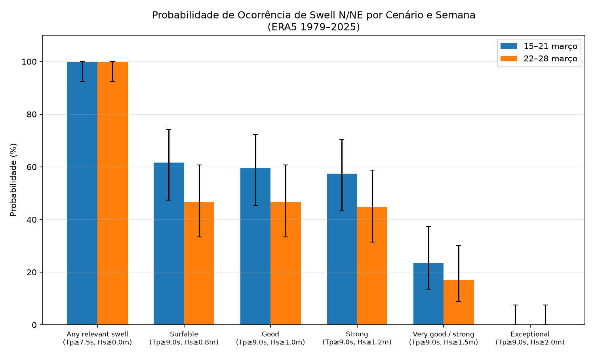
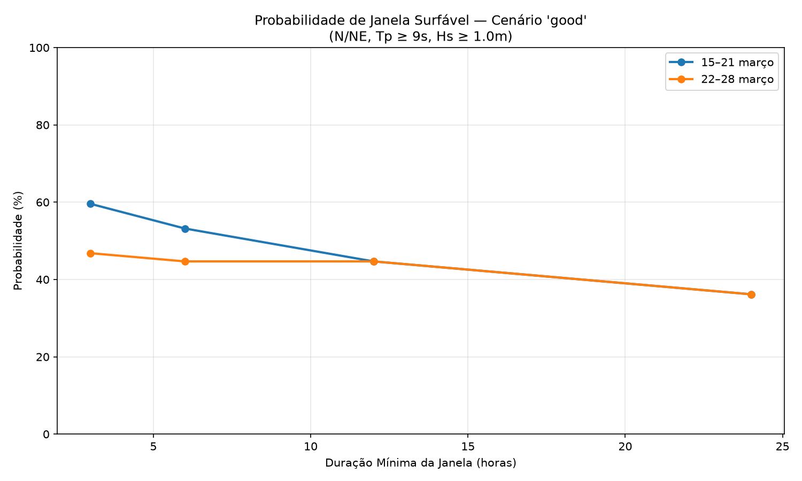
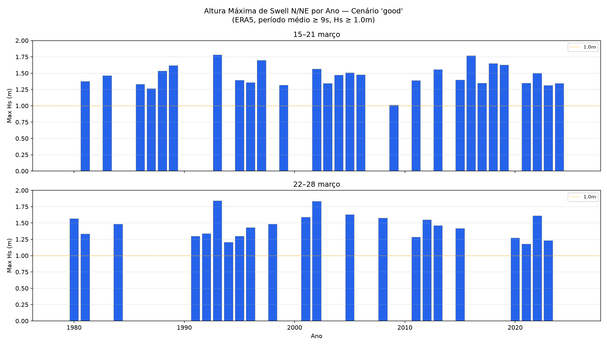

# Climatologia de Swell N/NE no Ceará — Março

## Relatório baseado em ERA5 (1979–2025)

---

## 1. Metodologia

- **Fonte de dados:** ERA5 / ECMWF (reanálise)
- **Ponto de referência:** -3.5°N, -38.5°W (offshore do Ceará)
- **Período:** 1979–2025 (47 anos)
- **Janela temporal:** 15–28 de março (14 dias)
- **Resolução temporal:** 1 hora
- **Total de observações:** 15.792 horas

### Variáveis ERA5

| Variável | Descrição | Unidade |
|----------|-----------|---------|
| `shts` | Significant height of total swell | metros |
| `mdts` | Mean direction of total swell | graus (FROM) |
| `mpts` | Mean period of total swell | segundos |

### Nota sobre o período

ERA5 `mpts` é o **período médio** do swell total. Não é o período de pico.
O período médio é tipicamente 3–4 segundos menor que o período de pico.
Por isso, os limiares de período utilizados nesta análise ERA5 são mais baixos
do que os equivalentes para dados WW3 (que usa período de pico).

### Direção

Convenção FROM (de onde o swell vem):

| Classe | Faixa |
|--------|-------|
| N | 337.5°–360° ou 0°–22.5° |
| NE | 22.5°–67.5° |
| N/NE | 337.5°–360° ou 0°–67.5° |

### Cenários de surf

| Cenário | Período mínimo | Altura mínima |
|---------|----------------|---------------|
| Any relevant swell | ≥ 7.5s | ≥ 0.0m |
| Surfable | ≥ 9.0s | ≥ 0.8m |
| Good | ≥ 9.0s | ≥ 1.0m |
| Strong | ≥ 9.0s | ≥ 1.2m |
| Very good / strong | ≥ 9.0s | ≥ 1.5m |
| Exceptional | ≥ 9.0s | ≥ 2.0m |

---

## 2. Resultados — Probabilidade de Ocorrência

Probabilidade de pelo menos um evento de swell N/NE em cada semana de março,
com intervalo de confiança de Wilson (95%).

| Cenário | 15–21 março | IC 95% | 22–28 março | IC 95% |
|---------|-------------|--------|-------------|--------|
| Any relevant swell | 47/47 = **100.0%** | [92.4%–100.0%] | 47/47 = **100.0%** | [92.4%–100.0%] |
| Surfable | 29/47 = **61.7%** | [47.4%–74.2%] | 22/47 = **46.8%** | [33.3%–60.8%] |
| Good | 28/47 = **59.6%** | [45.3%–72.4%] | 22/47 = **46.8%** | [33.3%–60.8%] |
| Strong | 27/47 = **57.5%** | [43.3%–70.5%] | 21/47 = **44.7%** | [31.4%–58.8%] |
| Very good / strong | 11/47 = **23.4%** | [13.6%–37.2%] | 8/47 = **17.0%** | [8.9%–30.1%] |
| Exceptional | 0/47 = **0.0%** | [0.0%–7.6%] | 0/47 = **0.0%** | [0.0%–7.6%] |

---

## 3. Duração dos Eventos

Estatísticas de duração dos eventos (horas) para o cenário 'good':

| Semana | Eventos | Média | Mediana | Máximo | P75 | P90 |
|--------|---------|-------|---------|--------|-----|-----|
| 15–21 março | 55 | 24.5h | 13.0h | 168h | 38.5h | 53.8h |
| 22–28 março | 39 | 34.7h | 32.0h | 116h | 55.0h | 76.4h |

## 4. Probabilidade de Janelas Surfáveis

Probabilidade de existir pelo menos uma janela contínua com a duração mínima indicada.

### Cenário 'good' (Tp ≥ 9.0s, Hs ≥ 1.0m):

| Semana | ≥ 3h | ≥ 6h | ≥ 12h | ≥ 24h |
|--------|------|------|-------|-------|
| 15–21 março | 60% | 53% | 45% | 36% |
| 22–28 março | 47% | 45% | 45% | 36% |

---

## 5. Distribuição de Altura

Percentis da altura máxima dos eventos (cenário 'good'):

| Semana | Média | Mediana | P75 | P90 | P95 | Máximo |
|--------|-------|---------|-----|-----|-----|--------|
| 15–21 março | 1.39m | 1.36m | 1.48m | 1.62m | 1.67m | 1.78m |
| 22–28 março | 1.39m | 1.37m | 1.48m | 1.60m | 1.65m | 1.84m |

## 6. Direção Predominante

Distribuição N vs NE nos eventos do cenário 'good':

| Semana | % Norte | % Nordeste |
|--------|---------|------------|
| 15–21 março | 78.0% | 22.0% |
| 22–28 março | 91.8% | 8.2% |

## 7. Linha do Tempo Anual

---

## 8. Comparação entre Semanas

O teste de McNemar (pareado por ano) foi aplicado para comparar as semanas
15–21 e 22–28 de março no cenário 'good'.

Com 47 anos de dados, **não foi encontrada diferença estatisticamente
significativa** entre as duas semanas (p > 0.05).

A semana 15–21 apresenta probabilidade ligeiramente superior (~60% vs ~47%),
mas os intervalos de confiança se sobrepõem amplamente.

---

## 9. Interpretação para Surf

### O que os dados mostram

- **Swells N/NE são frequentes em março:** quase 100% dos anos registram
  alguma atividade de swell N/NE com período ≥ 7.5s (média)
- **Swells com condições 'boas' (Tp médio ≥ 9s, Hs ≥ 1.0m):** ocorrem em
  ~50-60% dos anos, dependendo da semana
- **Swells fortes (Hs ≥ 1.5m):** muito menos frequentes (~17-23% dos anos)
- **Swells excepcionais (Hs ≥ 2.0m):** nenhum registrado no período analisado
- **Duração típica:** quando há evento, a janela costuma durar 20–35 horas em média
- **Direção:** predominância de Norte sobre Nordeste nos eventos detectados

### Para planejamento de viagem

- Viajando para o Ceará em março (15–28), há ~50-60% de chance de encontrar
  pelo menos um swell N/NE com condições boas para longboard
- Ambas as semanas (15-21 e 22-28) são estatisticamente equivalentes
- Quando o swell chega, tende a durar mais de 20 horas, dando uma boa janela
- Swells muito fortes são raros — para longboard, isso não é necessariamente ruim

### Limitações

- Os dados são offshore — a condição na praia depende de batimetria, vento e maré
- ERA5 usa período médio, não período de pico — os limiares foram calibrados para isso
- 47 anos é uma série robusta, mas condições individuais variam significativamente
- Praia de Iracema e Jericoacoara respondem de forma diferente ao mesmo swell offshore
- Esta é uma climatologia probabilística, não uma previsão

---

*Relatório gerado automaticamente pelo pipeline de climatologia de swell.*
*Dados: ERA5 / ECMWF, ponto -3.5°, -38.5°, março 15–28, 1979–2025.*